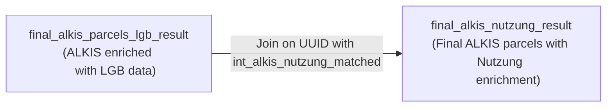

Below is a short README snippet that explains your final stage along with a Mermaid diagram. This final stage involves two models:

1. **final_alkis_parcels_lgb_result:**  
   - Built by joining the ALKIS data (from stg_alkis) with LGB data (from int_alkis_lgb_matched) to enrich each parcel with LGB attributes (lgb_art_values and lgb_typ_values).

2. **final_alkis_nutzung_result:**  
   - Further enriches the ALKIS parcels (now containing LGB data) by joining with the Nutzung data (from int_alkis_nutzung_matched) on UUID.  
   - It aggregates the unique Nutzung types into a column called nutzart_list_final.

The following Mermaid diagram summarizes the final stage:

### Explanation:
- **F1:** This model contains ALKIS parcels enriched with LGB data (columns like lgb_art_values and lgb_typ_values).
- **F2:** This model is created by joining F1 with the intermediate Nutzung matching results (int_alkis_nutzung_matched) based on the parcel's UUID. The final model includes a new column, **nutzart_list_final**, which holds an array of unique Nutzung values.
- When you run `dbt run`, dbt will build F1 first (using its dependency on staging and intermediate LGB models) and then build F2 by joining F1 with the intermediate Nutzung model.

This approach ensures that your final output reflects the latest ALKIS parcels enriched first with LGB data and then with Nutzung information.