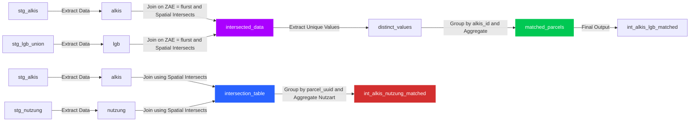

Below is a short README section for the intermediate stage:

---

# Intermediate Stage Overview

In the intermediate stage, we enrich our ALKIS parcel data by integrating additional datasets using spatial and attribute-based matching. The process is divided into two main parts:

- **LGB Matching:**  
  - We join the ALKIS parcels (from `stg_alkis` - raw alkis parcel data) with the unified LGB data (from `stg_lgb_union`, mergerd LGB dataset from masteportal) based on matching parcel identifiers (e.g., ZAE equals flurst) and spatial intersections.
  - We then aggregate distinct LGB classification fields (`art` and `typ`) for each parcel.

- **Nutzung Matching:**  
  - We join ALKIS parcels with the cleaned Nutzung data (from `stg_nutzung`) using spatial intersections.
  - Only intersections with an area greater than 1 m² are considered.
  - Unique normalized usage types are aggregated into an array per parcel.

This intermediate processing provides enriched datasets that capture both LGB and Nutzung information, serving as the foundation for our final output models.

