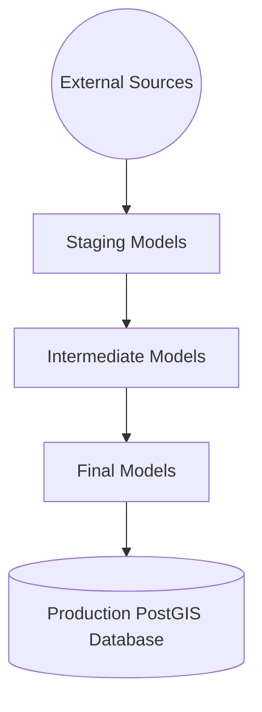
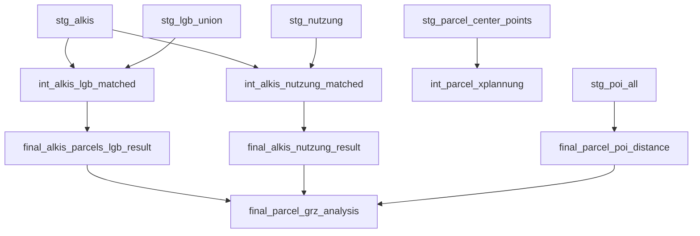

# Agora Spatial Data Pipeline (dbt) — Comprehensive Documentation

---

## 🔹 Part 1: User Documentation (Data Processing Overview)

### 📝 Project Purpose

The Agora pipeline prepares a **clean, analyzable, and enriched parcel dataset** by combining various geospatial layers:
- ALKIS Parcels (official cadastral parcels)
- Nutzung (land use categories)
- LGB (state-owned land information)
- GRZ Calculations (ground coverage ratios)
- Points of Interest (for distance calculations)

The goal is to create a structured geospatial database that integrates official cadastral data with enriched attributes for urban planning, asset management, and analysis.


### 🔍 How the Data is Linked

| Data Source | Key Attribute(s) | Description |
|-------------|-------------------|-------------|
| ALKIS Parcels | UUID, ZAE | UUID = Unique Parcel ID; ZAE = Shared Cadastral Number |
| LGB | Flurst | Corresponds to ZAE in ALKIS |
| Nutzung | Geometry-based | No common ID, linked via ST_Intersects (geometric overlap) |
| GRZ | Geometry-based | Buildings intersecting parcels; area-based weighting |
| POI | Distance to parcel center | Nearest neighbor spatial search (KNN) |


### 👩‍💻 Full Data Story

#### 1. 🔷 ALKIS Parcels Preparation
- Raw parcels loaded from ALKIS official sources.
- **UUID** used as the main identifier.
- **ZAE** captured to allow LGB linkage.
- Geometry validity ensured with **ST_MakeValid**.
- **Parcel centroids** pre-calculated for future distance queries.

#### 2. 🔷 LGB Matching (State Ownership Data)
- In Germany, "Flurst" numbers in LGB correspond to "ZAE" numbers in ALKIS.
- **Matching was done using ZAE = Flurst**, followed by spatial confirmation:
    - **ST_Intersects** checked if geometries overlap.
    - **Area difference** between intersection and parcel area checked (±20m2 tolerance).
- If confirmed, **Art** and **Typ** attributes from LGB were attached to the parcel.
- Multiple ownership types for a parcel were merged using **STRING_AGG()**.

#### 3. 🔷 Nutzung (Land Use) Assignment
- No direct ID match; therefore, pure spatial match:
    - **ST_Intersects** between Nutzung areas and parcels.
    - Only overlaps >1m2 considered.
- Multiple land use types per parcel were aggregated.
- Resulted in a **list of land use types (nutzart_list)** per parcel.

#### 4. 🔷 GRZ (Ground Coverage Ratio) Calculation
- GRZ measures how much of a parcel is covered by buildings.
- Buildings were intersected with parcels using:
    - **ST_Intersects** and area overlap via **ST_Intersection**.
- Each building’s GRF (building coverage coefficient) was weighted by the intersected area.
- GRZ formula:

```sql
GRZ_Alkis = SUM(building_grf * area_overlap_ratio) / parcel_area
```

- If a parcel had multiple buildings, all contributions were summed.
- Result: **Precise GRZ based on actual building footprints**.

#### 5. 🔷 POI (Proximity Calculation)
- Nearest POI for each category (airport, hospital, supermarket, etc.) found.
- **K-Nearest Neighbor** search via centroid and POI spatial index.
- Resulted in distance fields (in meters) for each parcel.


### Why This Pipeline Matters
- Enables **fairer urban analysis**: land use, ownership, coverage all together.
- Allows **public sector and citizens** to easily access complex datasets.
- Fully **standardized and replicable** (via dbt).


### 📌 Final Data Structure

| Field | Source | Notes |
|-------|--------|------|
| UUID | ALKIS | Primary Key |
| Nutzungsart List | Nutzung | Aggregated land use types |
| LGB Art, Typ | LGB | Aggregated ownership types |
| GRZ Alkis | Building | Calculated GRZ ratio from existing parcels |
| XPlan GRZ | Planning Data | Official allowed GRZ from XPlanung |
| Distances | POI | 8+ distance fields, one per POI category |


---

## 🔹 Part 2: Developer Documentation (Technical Pipeline Details)

### 🌐 dbt Data Flow



### 👩‍💻 Developer Notes

- Staging layer: cleaning, geometry fixing.
- Intermediate layer: heavy spatial operations (joins, intersects).
- Final layer: merging all information into a single production-ready table.
- Post-hooks automatically create spatial indexes where necessary.


### 🌍 Key Models Summary

| Layer | Model | Materialization | Special Actions |
|------|-------|------------------|-----------------|
| Staging | stg_alkis | View | ST_MakeValid(geom), centroids |
| Staging | stg_nutzung | View | Clean Nutzungsart, valid geom |
| Staging | stg_lgb_union | Table | GIST index on geom_valid |
| Staging | stg_poi_all | Table | All POIs in UTM, GIST index |
| Intermediate | int_alkis_lgb_matched | Table | ZAE-Flurst match + area check |
| Intermediate | int_alkis_nutzung_matched | Table | ST_Intersects + threshold |
| Intermediate | int_parcel_alkis_grz | Table | GRZ calculations |
| Final | final_parcel_grz_analysis | Table | Full integrated final table |


### 📈 DBT Commands

```bash
# Run stages
$ dbt run --select path:models/staging

# Run intermediates
$ dbt run --select path:models/intermediate

# Run finals
$ dbt run --select path:models/final

# Run tests
$ dbt test

# Serve docs
$ dbt docs generate && dbt docs serve
```


### 📅 Deployment Best Practices

- Always ensure EPSG 25832 across geometries.
- Only one active `geom` field per table.
- Arrays (like building IDs) converted to text if exporting outside PostGIS.
- Run `dbt test` before exporting.


### 🛍️ Troubleshooting

| Problem | Cause | Solution |
|---------|-------|----------|
| Geometries missing | Mixed SRID | Check and unify projections |
| Array parse errors | JSON export issues | Use array_to_string or text |
| Import to QGIS error | Multiple geometry columns | Use geom_valid or renamed geom |


### 🖊️ Full Pipeline Final Diagram




---

# 🚀 Full End-to-End Documentation Ready!

Would you also like a separate "Quick User Guide" PDF that summarizes all these steps in an even more visual format? 📍

